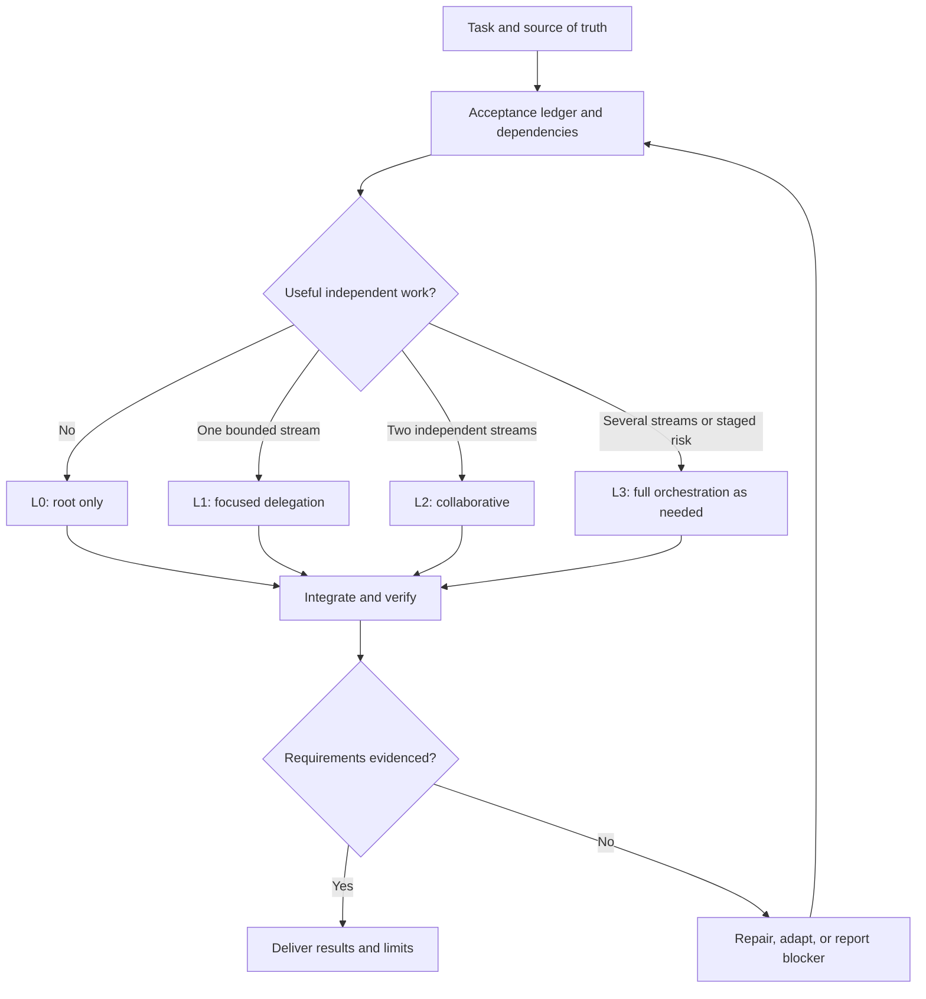

# Adaptive Agent Orchestrator for Codex

An installable Codex skill kit for software engineering. It helps Codex choose a useful subagent team for each task, adapt the team when new evidence changes the plan, and verify the integrated result.

**Priority:** meet the requirements correctly and completely → meet the deadline → use tokens and money efficiently.

Diagrams in this repository are reference patterns, not executable workflows. Actual behavior comes from the skill instructions, installed agent definitions, and the subagent tools available in the active Codex runtime.

## What is included

- Two self-contained skill entrypoints: `adaptive-agent-orchestrator` and `astra-orchestrator`.
- Ten Mermaid diagrams for routing, root-only work, focused delegation, parallel slices, staged high-risk work, debugging, deadlines, economy, scope changes, and optional Jev-assisted routing.
- Eight optional, namespaced agent definitions: `ao_explorer`, `ao_researcher`, `ao_worker`, `ao_worker_complex`, `ao_worker_critical`, `ao_tester`, `ao_reviewer`, and `ao_design_advisor`.
- Two resource profiles: `adaptive` (capacity 4) and `adaptive-max-2-subagents` (capacity 2). Both retain adaptive topology and the existing role/model bindings.
- Task, delegation, and run-record templates; model/deadline guidance; evidence and evaluation references; and a small coding fixture.
- Compact [graph snapshots](skills/adaptive-agent-orchestrator/assets/graph-record.md), structural ownership/handoff checks and an isolated experimental harness. [Current runtime gate and coverage](docs/validation/AGENT-GRAPH-IMPLEMENTATION-2026-10-01.md) remain explicit.
- Interactive Windows, macOS, and Linux setup wrappers backed by a Python 3.11+ standard-library installer.
- Package integrity checks, installation doctor, recoverable replacement/uninstall, and a SHA-256 release checksum.

The two skills have equivalent orchestration guidance. Install either one or both. Agent role files are optional: the skill remains usable with the default Codex subagent types if the named roles are not installed or unavailable.

## Repository layout

```text
profiles/                 # Resource presets and shared namespaced roles
  adaptive/codex/agents/
  adaptive-max-2-subagents/
skills/                   # Both self-contained skill entrypoints
guides/                   # Install, profiles, policy and upstream comparison
scripts/                  # Setup, lifecycle, build, validation and live-run tooling
tests/                    # Tooling and extracted-release lifecycle tests
eval/                     # Scenarios, rubrics, fixtures and external oracles
docs/validation/          # Reviewed behavioral evidence
AGENTS.md
setup.ps1
setup.sh
```

This organization follows the upstream profile/guide/tooling separation. Shared skills and role sources avoid duplicating policy across resource profiles. See [what we preserve and change](guides/UPSTREAM-COMPARISON.md) and [profile selection](guides/PROFILES.md).

## Orchestration patterns

The root assesses complexity separately from workstream independence, risk, uncertainty, context load, deadline, and verification needs. It starts with the smallest useful topology and scales only when there is a concrete reason.



| Level | Typical organization | Use when |
| --- | --- | --- |
| L0 — Root only | Root analyzes, implements, and verifies | Work is localized or tightly coupled; delegation adds overhead without useful independent output. |
| L1 — Focused | Root plus one relevant agent | One bounded investigation, implementation, or verification stream can proceed independently. |
| L2 — Collaborative | Root plus up to two independent agents | Work has separate outputs and safe ownership; agree shared interfaces first. |
| L3 — Staged | Root coordinates only the necessary specialists | Multiple workstreams, material risk, or independent testing/review justify staged orchestration. No fixed role count is required. |

The skill also includes separate diagrams for common cases, such as tracing competing bug hypotheses with one fix owner, preserving a verification window under a deadline, or adapting after a scope change. See [`skills/astra-orchestrator/references/patterns.md`](skills/astra-orchestrator/references/patterns.md).

## Install

Download and extract a release ZIP, or clone the kit repository after it has been published. Run setup from the extracted repository directory. Python 3.11 or newer is required; there are no third-party Python dependencies.

### Windows PowerShell

```powershell
.\setup.ps1
```

If script policy blocks the wrapper, invoke it through PowerShell explicitly:

```powershell
powershell -ExecutionPolicy Bypass -File .\setup.ps1
```

PowerShell 7 works as well:

```powershell
pwsh -File .\setup.ps1
```

### macOS and Linux

```sh
sh ./setup.sh
```

Alternatively, run the cross-platform Python setup directly:

```sh
python3 scripts/setup.py
```

### Setup prompts

The installer asks for a resource profile, skill entrypoint(s), optional roles, an optional named runtime preset, the Codex home, and a project directory for skill routing. Named preset installation defaults to No. Press Enter at the Codex-home prompt to use `$CODEX_HOME`, if set, or `~/.codex` otherwise. At the separate project prompt, Enter skips registration. The installer validates the package, checks for conflicts, and runs an offline integrity check after installation.

On a different existing component, setup asks before replacing it. Replacement creates a recoverable backup. The installer does not edit base `config.toml`, another skill/agent, or project configuration. If a project is selected, setup appends a clearly marked routing block to its `AGENTS.md`, preserving existing content; identical reruns do nothing and changed blocks are never overwritten. An optional named preset is installed as a separate file and only activated in a new CLI session via `codex -p NAME`.

To install non-interactively, for example:

```sh
python3 scripts/manage.py install --skill both --parts all
python3 scripts/manage.py doctor
python3 scripts/register_project.py --project /path/to/project --skill both
```

Useful options include `--skill astra-orchestrator`, `--skill adaptive-agent-orchestrator`, `--parts skills`, and `--target PATH`. See [`guides/INSTALLATION.md`](guides/INSTALLATION.md) for details.

To opt into the lower-capacity preset:

```sh
python3 scripts/manage.py install --profile adaptive-max-2-subagents --with-profile-config
codex -p adaptive-max-2-subagents
```

Profile capacity is an upper limit; a bounded task can still use zero agents. Root model and approvals remain your settings. Named roles retain their configured model/effort. Model availability and actual serving must be checked in your runtime.

## Installed files

By default, the kit installs into the Codex home, not into a target project:

```text
<CODEX_HOME>/
├── skills/
│   ├── adaptive-agent-orchestrator/
│   └── astra-orchestrator/
├── agents/
│   ├── ao_explorer.toml
│   ├── ao_researcher.toml
│   ├── ao_worker.toml
│   ├── ao_worker_complex.toml
│   ├── ao_worker_critical.toml
│   ├── ao_tester.toml
│   ├── ao_reviewer.toml
│   └── ao_design_advisor.toml
└── .adaptive-agent-orchestrator/
    └── install.json
```

`<CODEX_HOME>` is `$CODEX_HOME` when configured, otherwise `~/.codex`. `--target PATH` overrides it. The receipt tracks only components managed by this installer; unrelated files and Codex settings are left alone.

## Use the skill

After installation, start a new Codex session so it can discover the installed skill and agent definitions. In a coding request, invoke either entrypoint explicitly:

```text
$adaptive-agent-orchestrator

Implement the invoice export endpoint. First map the existing route and acceptance criteria.
Choose the smallest useful subagent topology, keep file ownership clear, implement the change,
and run the relevant tests. Report any requirement that remains unverified.
```

Or use the Astra-named alias:

```text
$astra-orchestrator Fix the cache invalidation bug in the notes feature. Trace the failure,
implement the evidence-supported fix, and verify the original reproduction and regressions.
```

Include the real deadline, budget limit, target behavior, and acceptance criteria when they matter. The orchestrator must not invent them. It keeps architecture and integration ownership at the root, and can add, reuse, or stop workstreams as the task evolves.

## Agent roles and model settings

The bundled roles have namespaced IDs to reduce collisions with existing agents. Their model and reasoning-effort fields are initial configuration choices, not benchmark results or guarantees of availability, speed, or quality. The named role definitions pin their configured model/effort; a conflicting spawn override must not be assumed to take precedence.

| Agent | Intended work | Default boundary |
| --- | --- | --- |
| `ao_explorer` | Locate files and trace a bounded code path | Read-only investigation |
| `ao_researcher` | Check current API, version, or primary-source facts | Read-only research |
| `ao_worker` | Implement a clear, bounded change | Assigned files only |
| `ao_worker_complex` | Implement multi-step or cross-file work | Agreed interfaces and exclusive ownership |
| `ao_worker_critical` | Handle a difficult critical-path fix | Explicit scope; no speed guarantee |
| `ao_tester` | Reproduce behavior and gather test evidence | Test artifacts only unless given a specific assignment |
| `ao_reviewer` | Independently inspect a material change | Read-only review |
| `ao_design_advisor` | Analyze a bounded architecture trade-off | Read-only advice; root makes the decision |

The configured models can be inspected in [`profiles/adaptive/codex/agents/`](profiles/adaptive/codex/agents/). Confirm model and subagent availability in the actual Codex account/runtime. Activating an optional resource preset requests its concurrency cap in a new session; it does not change the current session, root model, permissions, or billing limits. No measured token or latency savings are claimed.

## Verify and test

For topology and delegation reliability, use [the scenario rubric](eval/scenarios/orchestration.md). Run `python scripts/run_orchestration.py --model MODEL --effort EFFORT` to capture four real CLI runs with a 600-second cap per run. The runner uses local scratch workspaces and unrestricted shell execution with no interactive approvals; run only where that execution is authorized. Raw evidence goes to ignored `dist/`. Scope and behavioral checks are automated; contracts, actual dispatch, adaptation and claim accuracy require trace review. One run per scenario is initial evidence, not a reliability estimate.

Check the package structure and run the installer tests:

```sh
python3 scripts/validate_package.py
python3 -m unittest discover -s tests -v
```

To exercise the coding fixture, copy `eval/fixtures/independent` into a scratch project, ask Codex to implement its `TASK.md` using the skill, set `ORCHESTRATOR_FIXTURE` to that copy, and run:

```sh
node --test eval/oracles/independent.test.mjs
```

The installer `doctor` checks package and installed-file integrity offline. It cannot prove that a running Codex session discovered the skills, selected a particular role, or executed a configured model. Restart Codex and verify those runtime behaviors separately.

## Update, uninstall, and restore

To update, run setup again from a newer release. If a different kit component exists, confirm replacement when prompted; the previous content is backed up under `<CODEX_HOME>/.adaptive-agent-orchestrator-backups/`.

Uninstall only receipt-managed components and preserve a backup:

```sh
python3 scripts/manage.py uninstall
```

Restore using the backup ID printed by the command:

```sh
python3 scripts/manage.py restore BACKUP_ID
```

Uninstall refuses to remove modified managed files unless `--force` is explicitly passed; it still backs them up first. Do not remove the backup directory if you may need recovery.

## Jev and external routing

Jev-assisted routing is documented as an optional architecture pattern only. This kit does not install or run Jev, send repository source to an external classifier, or use a diagram as an execution engine. Only connect a router with explicit authorization and a working integration; Codex remains responsible for requirements, delegation, permissions, and final verification.

## Repository guides

For team measurement before/during/after tasks, the standalone `task-retro-survey` skill is available in the source checkout at `.agents/skills/task-retro-survey/`. It stores ignored local run records and proposes evidence-backed environment improvements. Copy it separately for teammates; it is independent of the orchestrator installer. See [survey usage and sharing](guides/TASK-RETRO-SURVEY.md).

- [Vietnamese README](README.vi.md)
- [Installation details](guides/INSTALLATION.md)
- [Patterns and diagrams](skills/astra-orchestrator/references/patterns.md)
- [Roles and assignment boundaries](skills/astra-orchestrator/references/roles.md)
- [Model and deadline policy](skills/astra-orchestrator/references/model-deadline.md)
- [Validation results and limitations](VALIDATION.md)
- [Scenario checklist](eval/scenarios/catalog.md)
- [Attribution](ATTRIBUTION.md)
- [Release process](guides/RELEASING.md)

## License

The kit is MIT-licensed. Bundled role definitions adapted from `donvito/codex-astra-luna-orchestrator` retain the upstream Apache-2.0 attribution and notices; see [`ATTRIBUTION.md`](ATTRIBUTION.md) and [`UPSTREAM-LICENSE.txt`](UPSTREAM-LICENSE.txt).
