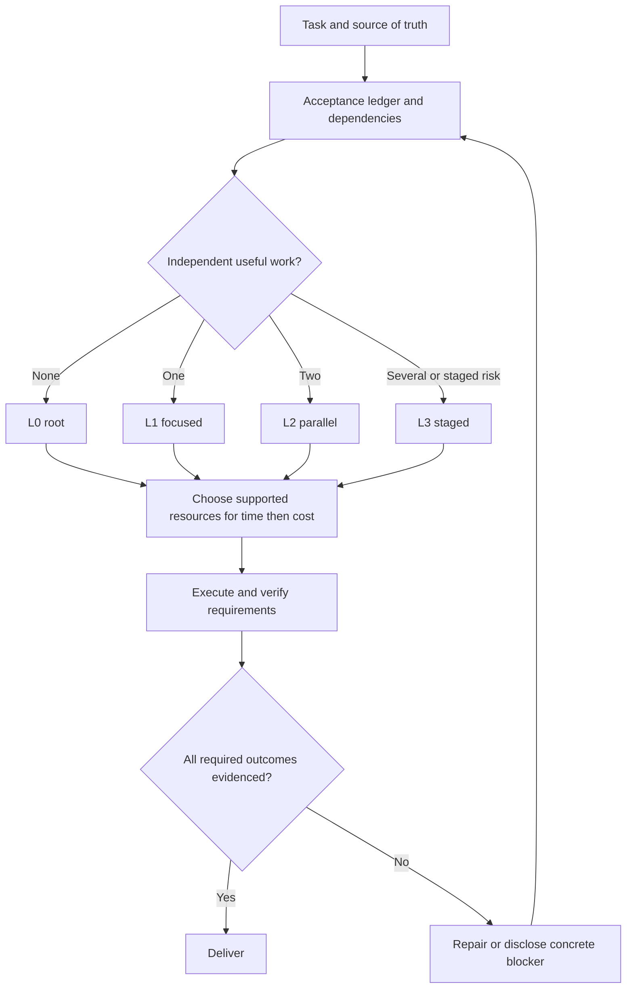
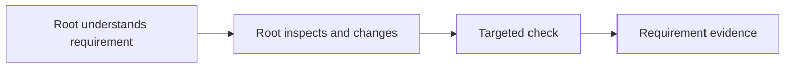
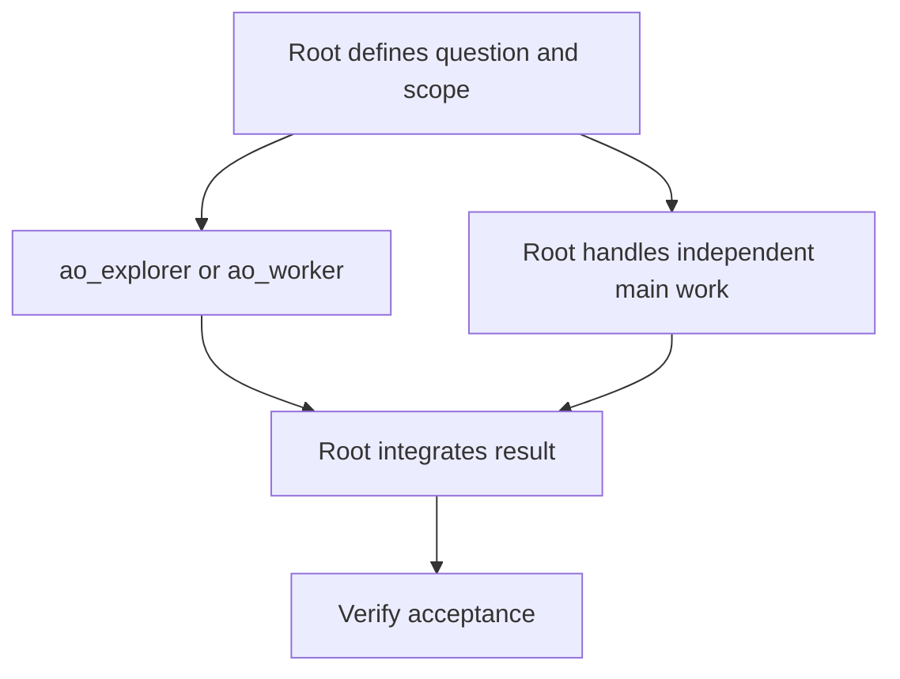
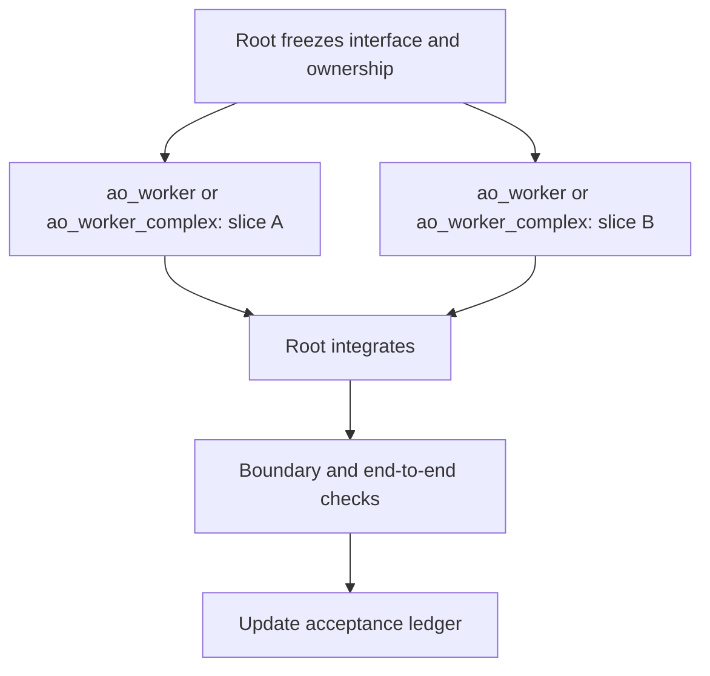
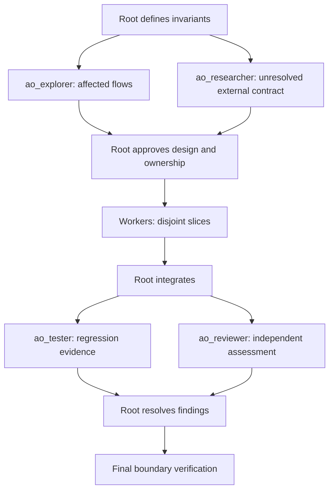
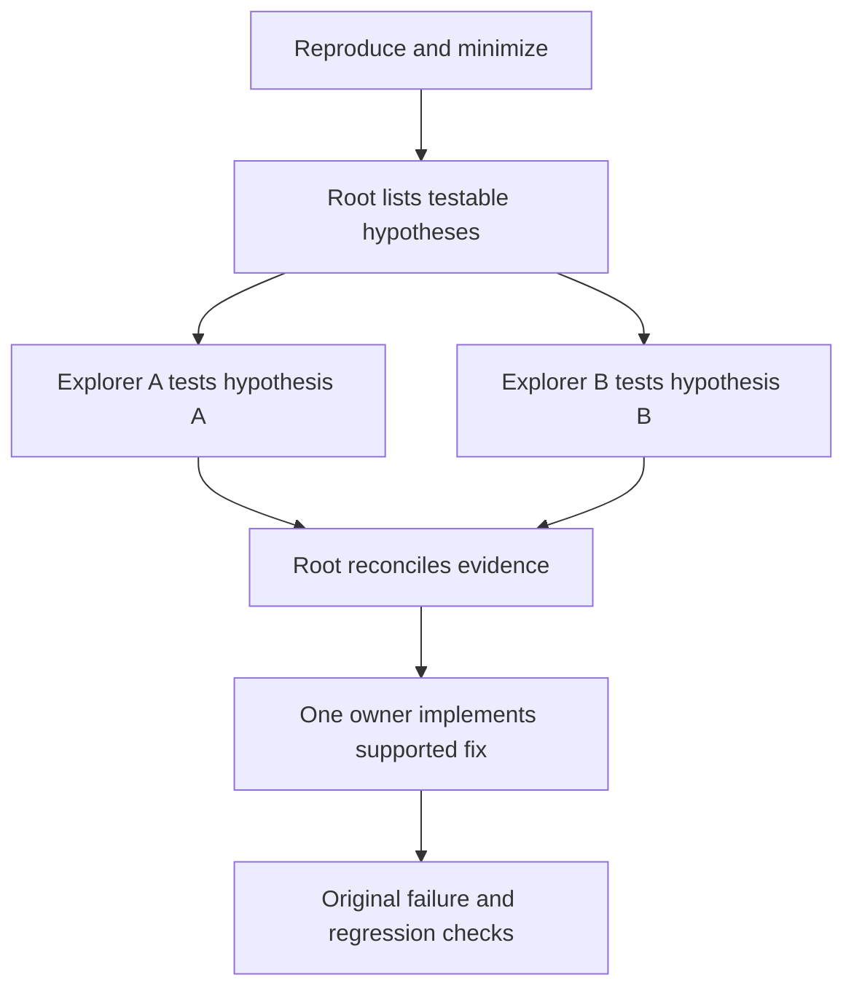
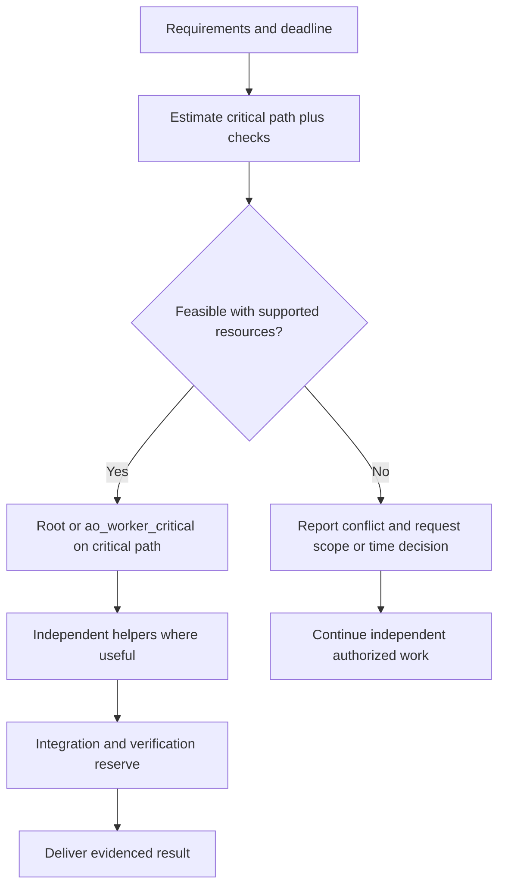
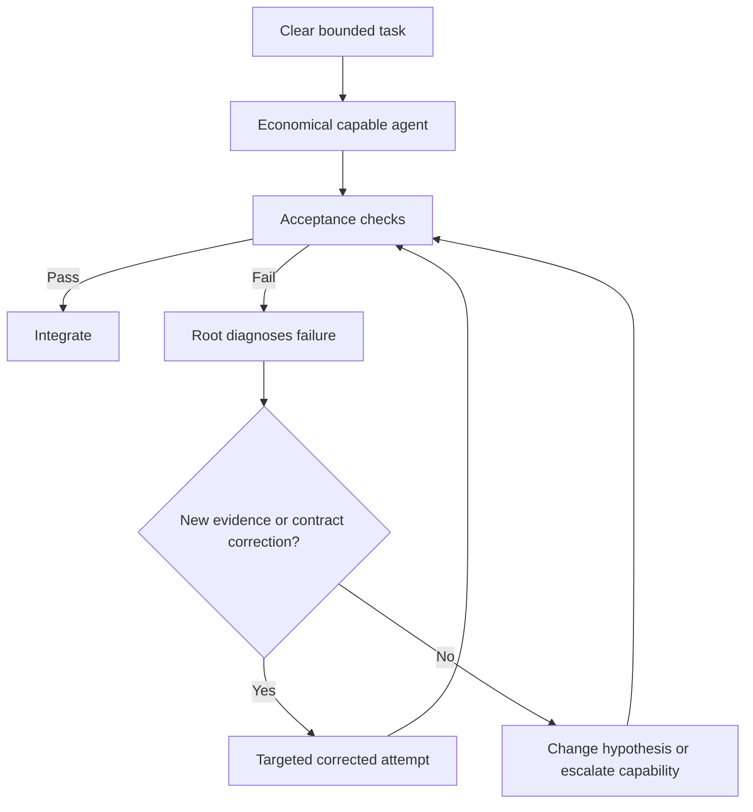
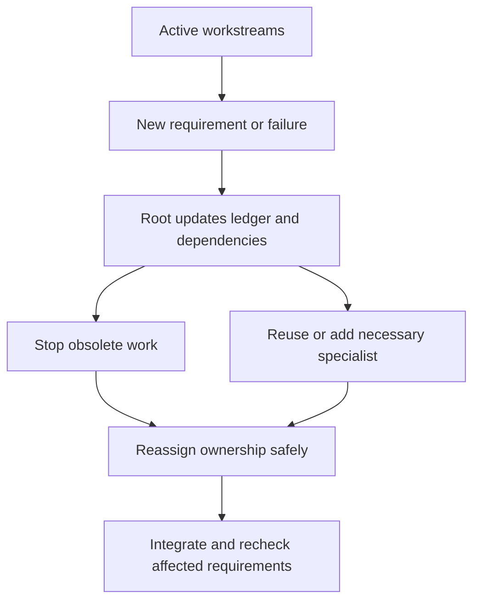
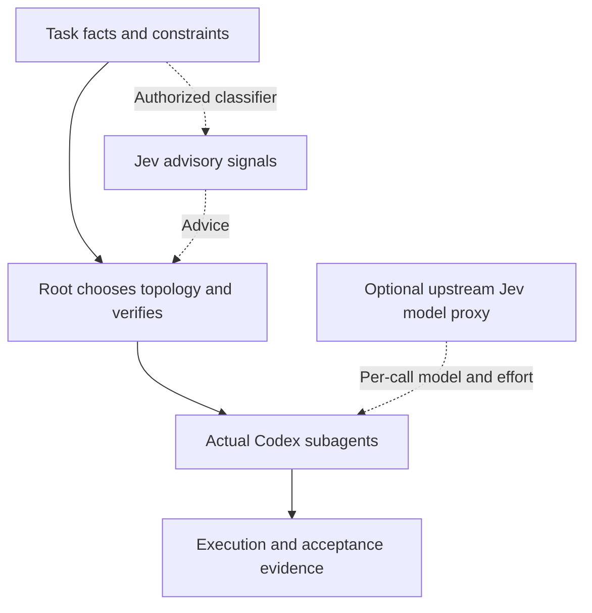

# Coding orchestration patterns — 10 diagrams

For coding execution, apply the [DeepSeek-first routing policy](deepseek-first.md) first. The Codex roles, capability examples and topology diagrams below describe planning or Codex fallback; they do not override the coding route or existing model pins.

Choose the smallest useful organization. Dashed edges are optional or advisory. Roles are assignments, not model pins. Every diagram inherits SKILL.md scope and verification rules.

These are organization examples, not live graph snapshots. For observed workstream IDs, agent assignments, ownership and replan deltas use the [graph record](../assets/graph-record.md); distinguish dependency edges from verification edges. Read only the matching case when possible.

## 1. Quality-first routing

## 2. L0 — small edit or tightly coupled reasoning

Use for three trivial CSS files just as readily as one; file count is not the criterion.

## 3. L1 — one bounded specialist

Root can advance independent work while the specialist works. A small task with no useful side work may stay L0.

## 4. L2 — parallel slices after interface agreement

Use for two independent components. Shared interface changes are agreed before workers start.

## 5. L3 — high-risk staged change

Use for auth, migrations, concurrency or broad contract changes when independent scrutiny adds value. For audits, all inspection stages stay read-only and implementation nodes are omitted.

## 6. Debug — competing hypotheses, one fix owner

Use parallel exploration only when there are distinct plausible causes. Do not run competing writers against the same files.

## 7. Deadline — critical path plus verification reserve

A deadline changes scheduling and resource choice, never the definition of done.

## 8. Economy — bounded work with evidence-based escalation

A cheaper first attempt is appropriate only when the task is sufficiently clear.

## 9. Changed scope or blocker — adapt the graph

## 10. Optional Jev — two routing layers

This is a proposed integration boundary, not an installed proxy or live classifier.

